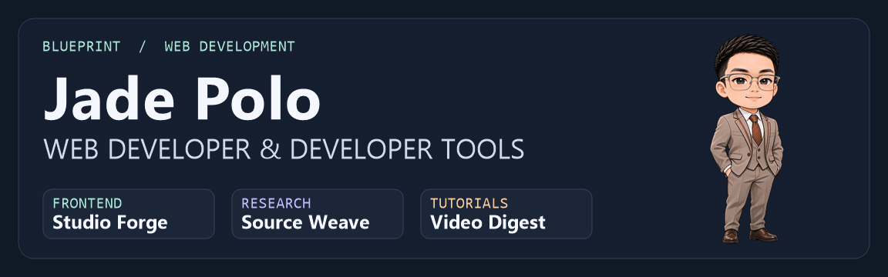

<picture>
  <source media="(prefers-reduced-motion: reduce)" srcset="assets/profile-banner-still.png">
  
</picture>

# Hi, I'm Jade Polo

**Web projects, frontend design, and tools for AI-assisted development**

I build practical web prototypes under Blueprint. After 10+ years in construction coordination, I still start projects the same way. I learn how people work, clarify what they need, and check how well the result fits. I use AI to help implement what I design, then review the behavior and refine it through testing.

[Explore my portfolio](https://jdpappdev.github.io/developer-projects/) · [LinkedIn](https://www.linkedin.com/in/jade-polo-a46833411/) · [Get in touch](https://jdpappdev.github.io/contact/)

## Developer tools I build in the open

I made these three tools to support my own work, from checking a source or studying a tutorial to designing and reviewing an interface.

### [Studio Forge](https://github.com/jdpappdev/Studio-Forge) · Design and build better interfaces

Four reusable skills for frontend design, React UI, motion, and interface review. The optional read-only MCP server lets coding agents look up design guidance, from responsive layouts to accessible interactions. [See the workflow and setup](https://github.com/jdpappdev/Studio-Forge#quick-start).

### [Source Weave](https://github.com/jdpappdev/Source-Weave) · Make research easy to verify

A research skill for comparing sources and repositories, checking claims, and turning findings into a recommendation you can trace back to the evidence. [Read a worked research example](https://github.com/jdpappdev/Source-Weave/blob/main/docs/reviews/2026-11-27-agent-skill-catalog-review.md).

### [Video Digest](https://github.com/jdpappdev/Video-Digest) · Turn tutorials into useful notes

A toolkit for YouTube and local recordings that collects timestamped captions and optional frame samples. Its Codex skills help create study notes and apply a reviewed tutorial to a project. [See a real Flexbox digest](https://github.com/jdpappdev/Video-Digest/blob/main/examples/chrome-devtools-flexbox.md).

## Selected web projects

- **Assured Capture Demo** is a field inspection prototype for recording issues, organizing photo evidence, and exporting reports. The public demo uses fictional inspections. [Try the demo](https://assured-capture-demo.vercel.app/) · [View the repository](https://github.com/jdpappdev/assured-capture-demo)
- **Plotline** is a browser-based workspace prototype for tracking projects, tasks, schedules, and team capacity. [Try the demo](https://plotline-phi.vercel.app/) · [View the repository](https://github.com/jdpappdev/Plotline)

My projects use HTML, CSS, JavaScript, React, TypeScript, and GitHub. I'm continuing to build my skills in frontend architecture, debugging, and testing.

**Open to junior frontend opportunities, remote project support, and collaborations.**
